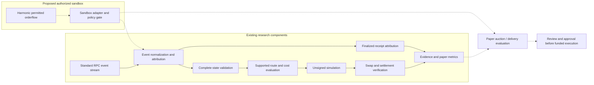

# Research architecture and proposed Harmonic integration

The current research pipeline is read-only and paper-only. The Harmonic adapter is proposed, not implemented or authorized. No trading executor is deployed.

Solid connections describe existing research components, not a claim that the entire pipeline has produced profitable swaps. Dashed connections are prospective. The public examples are standalone illustrations of event matching and the paper cost gate, not the actual internal pipeline.

## Sandbox integration plan

| Stage | Proposed validation |
| --- | --- |
| Authorized connection | Confirm allowed signals, access scope, message format, and searcher rules. |
| Event attribution | Match eligible signals to finalized receipt signatures and ordered transaction positions. Distinguish local receipt time from execution time. |
| State qualification | Require complete coherent state, supported liquidity, and validated accounts. Reject gaps, stale dependencies and inconsistent forks. |
| Paper evaluation | Compare eligible state with executable route pricing and conservative costs; retain unsigned simulation evidence where available. |
| Auction and delivery | Measure permitted sandbox feedback, acceptance and inclusion evidence separately from local decision latency. No assumed delivery advantage. |
| Review | Report coverage, timing, failures and economics; require provider approval and separate authorization before any funded execution. |

No credential material, operational endpoints, private market watchlists or submission implementation are provided.
